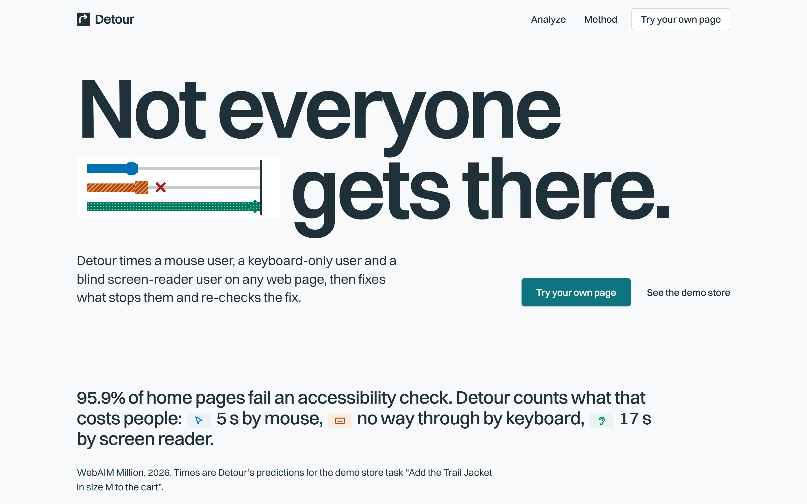
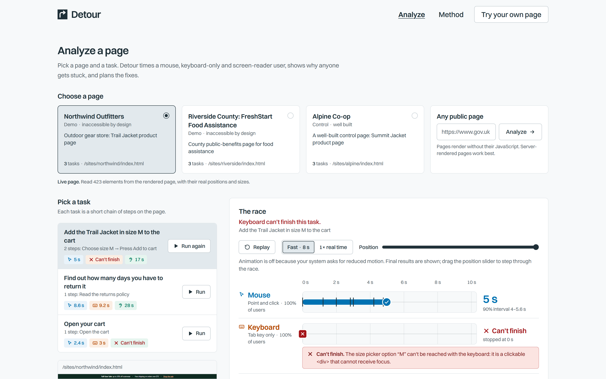
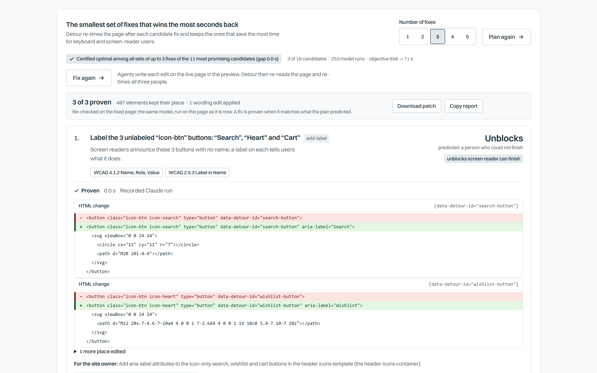
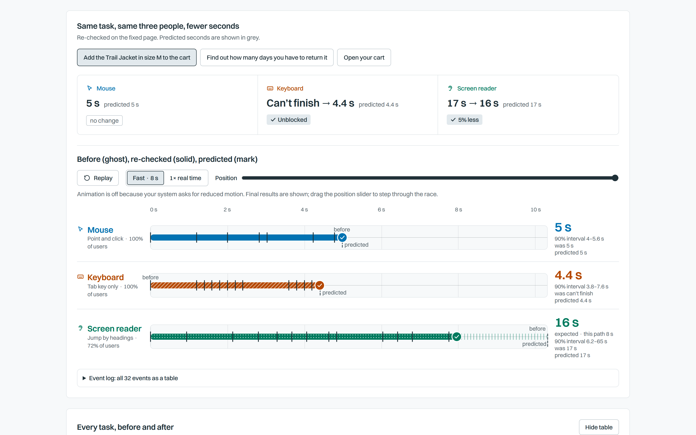
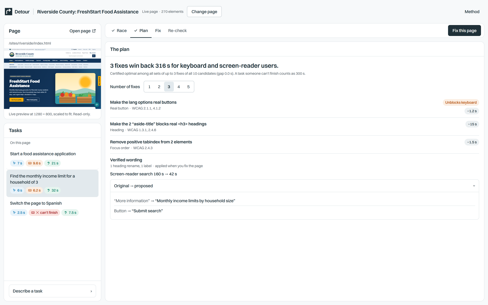
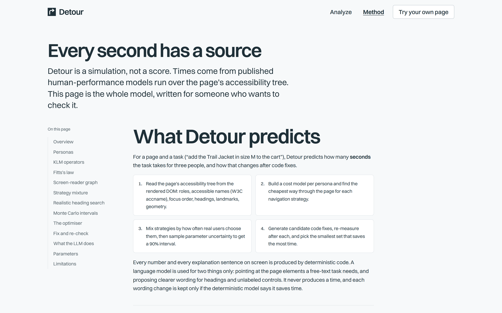
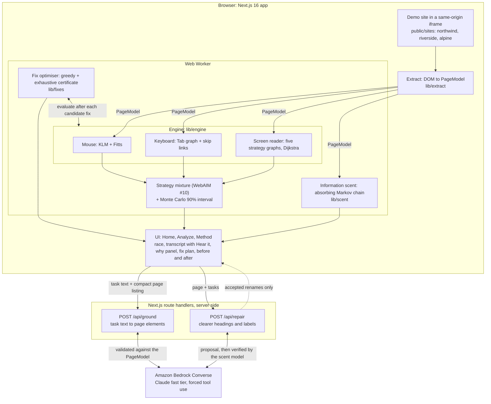

# Detour: accessibility, measured in seconds

> Audits list violations. Detour tells you what they cost real people in seconds, for a mouse user, a keyboard-only user and a blind screen-reader user, then plans the smallest set of code fixes that wins the most time back.

An accessibility audit can list hundreds of violations and still not say which ones matter. In the WebAIM Million 2026 survey, 95.9% of the top million home pages had detected WCAG 2 failures, 56.1 errors per page on average. Teams fix what is easy to fix. Finding out what a failure costs a person needs a user study with disabled participants, which is slow, expensive and rare. **Detour predicts that cost.** It reads the page the way assistive technology does, models how each kind of user would complete a task using established human-performance models (KLM-GOMS, Fitts's law, screen-reader navigation as shortest paths over the accessibility tree, a strategy mixture weighted by the WebAIM Screen Reader Survey, Monte Carlo intervals) and an information-scent search model, and answers: how many seconds, for whom, and which three fixes win the most back. A language model helps with words only; it never produces a number.

Live demo: TODO. Demo video: TODO.

## Highlights

<!-- Numbers measured in Chrome on the production build (real layout), 400 Monte Carlo samples, seed 1. -->

- **The keyboard user is locked out of the size picker.** On the Northwind Outfitters demo store the size options are clickable `<div>`s. A keyboard-only user cannot reach size M, so "Add the Trail Jacket in size M to the cart" is **blocked** for them. Detour says so, and why, in a plain sentence.
- **The screen-reader user cannot open the cart.** The cart is an icon-only button with no accessible name. The reader announces just "button". That task is **blocked** for a blind user.
- **Three fixes, certified.** From 18 candidate fixes, greedy picks three: label the icon buttons, make the size options real buttons, add a skip link. The objective (keyboard plus screen-reader seconds, a blocked persona charged 300 s) falls from 649.6 to 65.7. Both blocked cases are unblocked, and the skip link then cuts the keyboard user's size-M route from 18.4 s to 4.4 s. The plan is checked against exhaustive search over a pool of 11 candidates: **optimality gap 0.00**. On Riverside (10 candidates) the pool is all 10 and the gap is also 0.00.
- **Complementary fixes are why it is plain greedy.** The skip link alone changes nothing for the keyboard user (still blocked); the real-button fix alone leaves 18.4 s; together 4.4 s. Lazy greedy (CELF) would never re-examine the skip link, so we removed it ([`docs/MODEL.md`](docs/MODEL.md) section 9).
- **A vague heading is worse than none.** On the Riverside County food-assistance page, the income-limit table sits under a section titled "More information". After the headings are made real, a heading-navigating screen-reader user is predicted to need **160 s** to find the limit for a household of 3 (3% chance of opening the right section first; about 13 wrong sections entered), against a best case of 18 s that a shortest-path model charges for the same page. Claude proposed the heading "Monthly income limits by household size"; the scent model re-ran the search and the expected time drops to **42 s**, a 74% cut. A rename is accepted only when the model verifies that it saves time, and the app shows the ones it rejects (two of Claude’s other suggestions would have made search slower).
- **It does not cry wolf.** On the well-built control page (Alpine Co-op) Detour finds 0 candidate fixes and says "Nothing worth fixing".
- **Consistent with field data.** Bigham et al. (2007, WebinSitu) measured blind users taking 1.5 to 4.5 times as long as sighted users on matched web tasks (2.2 times to issue a query, 4.5 times to click a result). For adding the jacket to the cart, the model's screen-reader to mouse ratio is **3.5×** (17.3 s against 5.0 s), inside that range. This is a sanity check, not a validation ([`docs/MODEL.md`](docs/MODEL.md) section 12).
- **The search model is checked three ways.** The information-scent Markov chain matches a seeded 20,000-user simulation within 0.53% of mean time on 100 random pages (worst case), and an independent reference implementation to 1e-9.
- **Engineering rigor.** 558 unit and property tests, brute-force oracles for the shortest paths, and Playwright end-to-end tests that include an axe scan of our own UI (0 violations) and a keyboard-only walkthrough ([details](#tests-and-verification)).

### Northwind Outfitters, per persona, before and after the 3-fix plan

Point estimates in seconds (the app shows each with its 90% Monte Carlo interval).

| Task | Mouse | Keyboard-only | Screen reader |
|---|---|---|---|
| Add the Trail Jacket in size M to the cart | 5.0 → 5.0 | **cannot finish** → 4.4 | 17.3 → 17.4 |
| Find out how many days you have to return it | 8.6 → 8.6 | 9.2 → 9.2 | 28.2 → 30.5 |
| Open your cart | 2.4 → 2.4 | 3.0 → 3.2 | **cannot finish** → 6.6 |

Two screen-reader cells get slower after the plan, and the model says why rather than hiding it: a real button is announced "button, M, not pressed" (four words) instead of "clickable, M" (two), so a reader who passes the five size options hears a little more, and once the size picker is reachable the slow Tab-only strategy rejoins the strategy mixture. The optimiser accepts that trade because the keyboard user can finish.

Riverside County FreshStart Food Assistance, same method: "Switch the page to Spanish" is blocked for a keyboard user (the language options are clickable `<span>`s) until the plan makes them real buttons (1.8 s). The plan takes the objective from 369.9 to 56.7 with three fixes, gap 0.00.

## Screenshots

<!-- Captured from the production build by a Playwright script: 1600 x 1000 viewport at 2x, prefers-reduced-motion: reduce so races show their final state. Keep these exact names. -->
| | |
|---|---|
|  |  |
| **Home**: the problem and a three-lane teaser | **Analyze**: pick a page and a task, race the three users, read why the keyboard lane stops |
|  |  |
| **Fix plan**: ranked fixes, code diffs, WCAG criteria, optimality certificate | **After Apply plan**: the same race again, before (ghost) and after (solid) |
|  |  |
| **Riverside County**: Claude proposes wording, the scent model checks the seconds | **Method**: every formula, parameter and source, in the open |

## Architecture



**Key principle:** every number comes from deterministic code. The language model sits behind two server routes, its output is validated before use, and every path has an offline fallback, so the demo works with no keys.

## How it works

1. **Extract** (`lib/extract/`). Walks a live same-origin iframe in document order and builds a `PageModel`: roles and accessible names (`dom-accessibility-api`), states, NVDA-style browse-mode reading stops, the sequential focus order (positive `tabindex` first, negative and disabled excluded), headings, landmarks, skip links and the layout rectangle of every node. It also attaches heuristic hints for the fix generator: text that looks like a heading (size and weight) but is not one, clickable elements that cannot take focus, and unlabeled controls. The announcement printer (`lib/a11y/announce.ts`) is shared with the engine.
2. **Ground** (`lib/llm/`, `app/api/ground/`, `fixtures/tasks/`). A task such as "Add the Trail Jacket in size M to the cart" becomes an ordered list of steps (`activate`, `select`, `type`, `read`) pointing at nodes. The demo tasks are hand-pinned; free text goes through Claude on Amazon Bedrock with forced tool use, and the result is validated against the `PageModel` (retry once with the errors, else fail).
3. **Plan a route per persona** (`lib/engine/`). Mouse: `M`, scroll, a Fitts's-law pointing time, then a click. Keyboard-only: shortest path over Tab, Shift+Tab and skip-link edges. Screen reader: Dijkstra over the browse-mode reading order, where commands (next item, next heading, next landmark, Tab, Find) are edges costing a keystroke plus the speech of what is heard, for five navigation strategies. A control the persona cannot operate (not focusable, or no accessible name) makes that strategy **blocked**.
4. **Mix and bound** (`lib/engine/persona.ts`, `montecarlo.ts`). Screen-reader strategies are weighted by the WebAIM Screen Reader User Survey #10 (headings 71.6%, Find 13.6%, read through 6.4%, links 4.8%, landmarks 3.7%). 400 seeded Monte Carlo samples over the literature's parameter ranges give a 90% interval.
5. **Search realistically** (`lib/scent/`). The shortest path assumes the user knows which heading holds the answer. The scent model drops that: an absorbing Markov chain over the heading order, with `N = (I - Q)^-1` giving expected time, wrong sections entered and the chance of finding the target first time.
6. **Explain** (`lib/engine/explain.ts`). Deterministic sentences built from the traces: "A keyboard user cannot choose size M. The colour forest picker option "M" can't be reached with the keyboard: it is a clickable `<div>` that cannot receive focus." No language model writes any explanation.
7. **Plan the fixes** (`lib/fixes/`). Candidate fixes are generated from the page (skip link, promote a styled heading, add a landmark, label a control, replace a fake button, remove a positive `tabindex`), grouped by component, and applied as pure transforms on the `PageModel` with an HTML before and after patch and the WCAG 2.2 criteria. Plain greedy picks up to `k`; for `k <= 3` an exhaustive search certifies it.
8. **Repair wording** (`lib/repair/`, `app/api/repair/`). Claude proposes a clearer heading for a vague one, or a name for an unlabeled control; the scent model re-runs the search on the renamed page and the rename is accepted only if it saves more than half a second.
9. **Show it** (`app/`, `components/`). Three lanes race on one clock; the screen-reader lane has a transcript and **Hear it**, which speaks the utterances with the browser's speech synthesis at the modelled rate. Then the fix plan with diffs, then the same race again with the before as a ghost.

## The model

The full specification is [`docs/MODEL.md`](docs/MODEL.md). It is written to be checked: every formula, every parameter with its source and range, the blocked conditions, and twelve numbered limitations. The parameter table in it is generated from `lib/params/literature.ts` and a test fails if the two drift apart.

A prediction is the expected time for a **practised user who knows what to do and where to find it**: a best case, meant for comparison (which persona is hit hardest, which fix helps most), not a forecast of anyone's stopwatch. The point estimate uses nominal parameters; the 90% interval is the 5th to 95th percentile over their ranges.

| Quantity | Nominal (range) | Source |
|---|---|---|
| Keystroke `K` (Tab, arrow, H, D) | 0.20 s (0.12 to 0.28) | Card, Moran & Newell 1980, 1983, as tabulated in Kieras 2001 |
| Mental preparation `M`, one per step | 1.2 s (0.6 to 1.35) | Kieras 2001, after Olson & Olson 1990 |
| Fitts's law, `MT = a + b log2(D/W + 1)` | a = 0.33 s, b = 0.17 s/bit | Soukoreff & MacKenzie 2004 (median of eight published mouse regressions) |
| Silent reading | 238 wpm (175 to 300) | Brysbaert 2019 (190 studies, 18,573 readers) |
| Screen-reader speech rate | 320 wpm (200 to 450) | Bragg et al. 2018 (mean maximum intelligible rate 297 to 334 wpm); Stent et al. 2011; Asakawa et al. 2003; a judgement, flagged as such |
| Fraction of a non-target announcement heard | 0.5 (0.25 to 1) | Modelling assumption; NVDA cancels speech on every key press |
| Typing | 0.24 s per character | Dhakal et al. 2018 (136 million keystrokes) |
| Keyboard motor factor, times `K` | 1 (1 to 3) | Trewin 1998 and Trewin & Pain 1999 (motor-disability typing 2.8 to 2.9 times slower) |
| Screen-reader strategy weights | headings 0.716, Find 0.136, linear 0.064, links 0.048, landmarks 0.037 | WebAIM Screen Reader User Survey #10, n = 1,511 |
| Blocked persona, in the optimiser | 300 s | Modelling choice: unblocking always beats shaving seconds |

The information-scent search adds four behavioural constants (`alpha`, `theta`, `beta`, `pMin2`) that are modelling assumptions and are labelled as such in [`docs/MODEL.md`](docs/MODEL.md) section 7a.

## What the LLM does and does not do

**Does** (Claude on Amazon Bedrock, fast tier, Converse API, forced tool use with a JSON schema):

- **Ground a task.** Plain-English task in, ordered steps out, as `{ target, action, text?, note? }` over a compact listing of the page.
- **Propose wording.** A clearer heading for a vague one, a name for an unlabeled icon button.

**Does not:**

- It never produces a time, a weight, a parameter, an explanation or a fix choice. The seconds are Dijkstra, KLM, Fitts and a Markov chain.

**Every output is validated or verified before it is shown:**

- Grounded steps are checked against the `PageModel`: every id exists, `activate` and `select` hit actionable nodes, `type` hits a text field and carries text, `read` hits a reading stop, no empty or repeated steps, at most 12. One retry with the errors; a second failure is an error, not a guess.
- A proposed heading must differ from the current one and is limited to 6 words and 60 characters; then the **scent model re-runs the search with the new wording and the rename is accepted only if it saves more than 0.5 s**. Proposed names for unlabeled controls are checked for length and generic words.
- Page text and task text are treated as data, not instructions.

**Offline fallbacks:** with no credentials, `/api/ground` answers 503 and the app uses the hand-pinned fixture tasks; `/api/repair` answers with deterministic fallback wording, marked as such. The demo never depends on the model.

## Quick start

Needs Node 20 or newer and, for the end-to-end tests, Google Chrome.

```bash
npm ci
npm run dev        # http://localhost:3000
```

**No keys needed.** Everything in the product works without them: the demo sites, the pinned tasks, the model, the plan, the repair fallback. Keys only turn on Claude for free-text tasks and for proposed wording. To use them, create a `.env` at the repo root (it is gitignored) with these names:

| Variable | Meaning |
|---|---|
| `CLAUDE_AWS_ACCESS_KEY`, `CLAUDE_AWS_SECRET_KEY` | IAM user access key for Amazon Bedrock (long-lived; session tokens are not read) |
| `CLAUDE_AWS_REGION` | the region where your model or inference profile lives |
| `CLAUDE_AWS_MODEL` | strong tier: a model id, inference-profile id or ARN, passed unchanged as the Converse `modelId` |
| `CLAUDE_AWS_FAST_MODEL` | fast tier, same format |
| `OPENAI_API_KEY` | optional, only used to narrate the demo video |

No model id appears in the code.

Then try it: open **Analyze**, choose **Northwind Outfitters**, press **Run** on "Add the Trail Jacket in size M to the cart", press **Hear it**, then **Plan fixes** and **Apply plan**.

```bash
npm run typecheck   # next typegen + tsc
npm test            # vitest: unit, property and oracle tests (about 30 s)
npm run build
npx playwright test # end-to-end in the installed Chrome; builds and serves the app itself
```

## Tests and verification

`npm test` runs 558 tests in 52 files. The checks behind the claims above:

- **Shortest paths are exact.** `lib/engine/dijkstra.test.ts` compares Dijkstra with Bellman-Ford on random graphs, and checks that adding an edge never increases a cost and that ties break deterministically. `lib/engine/oracle.test.ts` compares every screen-reader strategy, and the keyboard Tab, Shift+Tab and skip-link path, with a brute-force shortest path on random pages, and checks that every emitted move is a legal command and that totals add up.
- **The Monte Carlo shortcut is checked.** Intervals re-cost each strategy's nominal-optimal path rather than re-searching per sample. `lib/engine/montecarlo.test.ts` re-runs the shortest-path search per sample and shows the median differs by less than 10% (and that re-optimising never costs more on average), that every interval contains its point estimate on random pages, and that a blocked strategy is never drawn.
- **The scent Markov chain is checked three ways.** `lib/scent/search.test.ts` compares the matrix solution with an independent reference to 1e-9 (300 random cases) and with a seeded 20,000-user simulation that shares no cost or matrix code with the model: worst error **0.53%** of mean seconds over 100 random pages (the test bound is 2%). `lib/scent/vague.test.ts` pins the vague-heading story, including that it is worse than no heading.
- **The greedy plan is certified.** `lib/fixes/plan.test.ts` checks the plan against exhaustive search, that the pool is the union of the top 8 per greedy round plus the picks above 14 candidates, that a fix whose single gain is negative but which pays off after another is found, and (on purpose-built instances) that greedy can be suboptimal and the gap then says so. `lib/fixes/sites.test.ts` runs the real engine on Northwind and finds the skip link that only pays off after the size picker is fixed.
- **Fixes are safe transforms.** `lib/fixes/properties.test.ts` applies random fix sequences to random pages: the result is always a valid `PageModel`, the input is never mutated, applying a fix twice equals once, and a set of fixes gives the same page in any order.
- **Extraction is stable.** Invariants and determinism on random documents, and precision tests so prices, ratings and statistics are not mistaken for headings (`lib/extract/`).
- **The LLM paths are contract-tested.** The listing, the validator, the retry, and the 503, 400, 422 and 502 responses are tested with an injected Bedrock stand-in; tests that call the real service skip themselves without credentials.
- **Documentation cannot drift.** `lib/params/literature.test.ts` fails if the parameter table in `docs/MODEL.md` differs from `lib/params/literature.ts`.
- **Our own UI passes its own audit.** The Playwright suite (`tests/e2e/`) runs an axe scan (WCAG 2.0 to 2.2, A and AA) on Home, Method and Analyze (empty, after a race, after a plan) and expects **0 violations**; a keyboard-only walkthrough drives the whole flow with Tab, arrows, Enter and Space and never touches the mouse; and a flow test checks that on Northwind the keyboard user is blocked and the 3-fix plan lets them finish.

## Limitations

State these when quoting a number. The long form is [`docs/MODEL.md`](docs/MODEL.md) section 13.

- **Not yet validated against a live screen reader or measured task times.** The parameters come from the literature and the field studies in section 12 are comparison targets only. The phrasing of announcements is NVDA-like (NVDA 2024 defaults); JAWS, VoiceOver and Narrator differ.
- **Best case, not a forecast.** The model finds the cheapest route within each strategy, as if the user already knew where things are. Real first-time users search, backtrack and make errors. Intervals describe parameter uncertainty, not differences between people.
- **Scent is lexical.** The shipped scorer is word overlap with a small synonym map, and it covers the headings strategy only. Its behaviour constants are assumptions. A Claude-proposed rename is verified by that same lexical model, so a rename can look better to the model than to a person; review the proposals.
- **Strategy weights are survey-based.** WebAIM respondents are self-selected and skew experienced, and the question asks what a user does first, which we treat as the whole-task strategy.
- **Mixtures can move the wrong way.** A blocked strategy is dropped from the average and the rest renormalised, so unblocking one can raise a persona's mean by a few seconds (we see it on Northwind).
- **The demo sites are synthetic and static.** No dynamic content, modals, focus traps, live regions, forms or network delays. Northwind and Riverside are invented, and built to be realistically inaccessible; Alpine is built properly as a control.
- **Fix gains are model gains.** They are the seconds the model saves, not measured improvements.
- **Scope.** Adult, English-language, desktop users. Beginners, braille users, mobile screen readers and non-English speech are outside the model.

## Responsible by design

- **Estimates, not verdicts.** Every time carries a 90% interval, every page of the Method section states its assumptions, and Detour never claims WCAG conformance or replaces testing with disabled people. It is meant to decide what to fix first and to make the cost visible to people who write the checks.
- **Personas by how they operate the page.** Mouse, keyboard-only and screen-reader users are defined by input and output modality; the model does not claim to represent any individual or any condition.
- **No surprises about data.** The pages analysed in the demo are our own synthetic sites. Credentials and model calls stay on the server; request bodies and secrets are never logged. There is no URL proxy, so the app cannot be pointed at third-party pages.
- **Deterministic explanations.** Numbers and reasons come from code that can be read and tested. The language model cannot invent a result.
- **We hold ourselves to the standard.** Our UI targets WCAG 2.2 AA, is fully keyboard operable, respects `prefers-reduced-motion`, and passes an automated axe scan with 0 violations.

## Repository layout

| Path | Contents |
|---|---|
| `lib/contracts/` | shared types: `PageModel`, `Task`, `TaskResult`, `FixSpec`, `FixPlan` |
| `lib/extract/` | DOM to `PageModel` |
| `lib/engine/` | cost models, navigation graphs, Dijkstra, strategies, mixture, Monte Carlo, explanations |
| `lib/scent/` | information-scent search: lexical scorer, absorbing Markov chain, simulation |
| `lib/fixes/` | candidate fixes, pure transforms, the optimiser |
| `lib/repair/`, `app/api/repair/` | proposed wording with model verification |
| `lib/llm/`, `app/api/ground/` | Bedrock client and task grounding |
| `lib/params/literature.ts` | every human-performance parameter with its source |
| `lib/a11y/announce.ts` | NVDA-style announcement printer |
| `public/sites/` | the three demo sites (Northwind, Riverside, Alpine) |
| `fixtures/` | pinned tasks, test page models, sample results |
| `app/`, `components/` | the UI |
| `tests/e2e/` | Playwright and axe |
| `docs/MODEL.md` | the model specification |

## Built with

Next.js 16, React 19, TypeScript (strict), Tailwind CSS 4, Amazon Bedrock (Claude, Converse API), `dom-accessibility-api`, Zod, Vitest, fast-check, jsdom, Playwright and axe-core.

**Built with Claude Code as an AI pair-programming assistant.**

## Attributions

The research Detour stands on (full references in [`docs/MODEL.md`](docs/MODEL.md) section 14):

- Card, Moran & Newell (1980, 1983) and Kieras (2001): the Keystroke-Level Model and its operator times.
- Fitts (1954), MacKenzie (1992), Soukoreff & MacKenzie (2004): Fitts's law, Shannon formulation, and mouse regression constants.
- Dijkstra (1959): shortest paths.
- Brysbaert (2019): reading rates. Bragg et al. (2018), Stent et al. (2011), Asakawa et al. (2003): listening rates. Dhakal et al. (2018): typing. Hinckley et al. (2002): scrolling. Trewin (1998) and Trewin & Pain (1999): keyboard use with motor disabilities.
- WebAIM, *Screen Reader User Survey #10* (2024): strategy weights. WebAIM, *The WebAIM Million* (2026): 95.9% of home pages with detected WCAG 2 failures.
- Bigham et al. (2007), *WebinSitu*, and Nielsen (2001): blind versus sighted task times, our validation targets.
- Pirolli & Card (1999), Fu & Pirolli (2007), Teo, John & Blackmon (2012): information foraging, SNIF-ACT and CogTool-Explorer, the basis of the search model.
- Minoux (1978), Leskovec et al. (2007), Nemhauser, Wolsey & Fisher (1978): lazy greedy and the submodular guarantee, the approach we deliberately do not use (fixes are complementary).
- NV Access, NVDA: the speech-cancellation behaviour and announcement conventions our phrasing follows.

The three demo sites and their SVG art are original to this project; Northwind Outfitters, Riverside County and Alpine Co-op are fictional.

## License

MIT. See [LICENSE](LICENSE).
